# 下单当天能否识别会延误的订单？

**Olist 平台在每日复核额度约束下的下单时延误预警研究（中文版，供组内审阅与排练）**

IS5126 期末项目 · 小组：_[组号与成员]_ · 证据：正式运行 `experiment-v2-002`，第二检验期运行 `experiment-v3-late2017-001`，分析层见 `artifacts/analysis/`

---

## 摘要

延误是 Olist 差评最明确的来源。在 96,470 个已签收订单中，6.8% 晚于承诺日期送达。晚到订单的一星差评率是 52.5%，准时订单只有 6.6%（平均评分 2.27 对 4.29）。

我们研究一个具体的运营决策：**运营团队每天晚上最多复核当天订单的 10%，只用下单时已知的信息，应该挑哪些订单？在下单这一刻采取行动值不值得？**

我们比较了 29 种排序方法：5 条简单规则和 24 个机器学习模型（逻辑回归和浅层决策树）。所有方法都按时间顺序评估：先在 2018 年 1 月到 4 月四个月度验证折上选出方法，再在之后 96 天的回测窗口（2018 年 5 月 26 日到 8 月 29 日）上只测试一次。为了检验结论能否换一个时期仍然成立，我们又冻结了第二套设计（三条新规则加考虑删失的标签），并在 2017 年末检验：6–9 月选模，10 月 26 日到 12 月 31 日测试。这段时期此前从未有任何模型打过分。

**主要发现**

1. **简单规则胜出，机器学习没有带来增益。** 入选规则把订单所在"卖家州 → 买家州"路线的历史延误率，乘以承诺时长的紧迫程度。它在验证期抓到 25.2% 的延误单，最好的模型是 21.0%。回测中也没有任何模型超过它。
2. **下单时的信号很弱。** 回测中规则共预警 1,885 单，抓到最终延误的 674 单中的 117 单，召回 17.4%、精度 6.2%（基础延误率 3.5%）。团队大约每复核 16 单才找到 1 单延误。
3. **两个时期的延误原因不同。**
   - 2018 年初，延误集中在跨州路线：跨州延误率 14.2%，州内 4.9%。
   - 回测期，问题转为本地短承诺：承诺 10 天内的订单占比从 1.2% 升到 15.0%，延误率 11.6%。其中仅圣保罗 → 圣保罗的短承诺订单就贡献了全部延误的 41%。
   - 在验证期毫无作用的"承诺越短越危险"规则，到回测期反而最好。但它的优势统计上不显著，我们也没有在看过测试结果后换用它。
4. **第二次、预先登记的检验确认了主要结论，并改进了规则。**
   - 模型仍然没有胜过规则。
   - 只用最近 60 天路线历史的新规则在选模中胜出，抓到 21.1% 的延误单（精度 21.6%，基础率 10.0%），比原规则多 7.7 个百分点；配对区间为 4.5 个百分点到 12.8 个百分点。
   - 在 2018 年事后看来最好的两条规则都失败了：承诺余量只抓到 8.3%，承诺越短规则只抓到 4.2%，都不如随机队列。
5. **下单时行动值不值得，取决于当时延误多不多。** 按事先固定的三种成本情景，在低延误的 2018 窗口，除最乐观情景外下单时队列都亏损；在高延误的 2017 年末窗口，它在中等情景下就能盈利。
6. **一个更晚、也更便宜的信号在两个时期都更准。** 卖家到发货期限仍未把订单交给承运商时就预警：
   - 在 2018 年（看过结果后才发现）精度 19.4%、召回 45.4%。
   - 在从未看过的 2017 年末窗口精度 28.9%、召回 34.0%，比下单时队列的精度高 7.3 个百分点（区间 1.4 到 13.6 个百分点）。

**建议**

- 不要组建大规模的下单时人工复核队列。
- 如果使用下单时排序，应基于最近 60 天的路线历史，只做每天排名最靠前的那部分，并按当时的延误率调整规模。
- 把人工跟进放到发货期限检查点。
- 复查本地短路线的承诺日期设定。
- 任何干预措施先做随机对照试点，再声称它能减少延误。

---

## 1. 问题与决策

### 1.1 背景

Olist 是巴西的电商平台，把小卖家接入大型电商网站。卖家打包后把订单交给承运商（主要是国家邮政），由承运商送达。买家结账时会看到承诺送达日期，日期一旦错过，买家会归咎于平台。

### 1.2 为什么重要

图 1B 显示了错过承诺的代价：
- 准时订单平均评分 4.29，一星占 6.6%。
- 晚到订单平均评分 2.27，一星占 52.5%，是准时订单的 7.9 倍。

晚到订单只占 6.8%，却主导了平台收到的负面反馈。

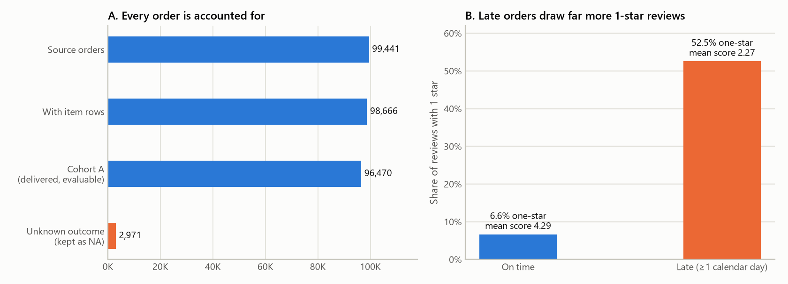

*图 1。A：每个源订单都归入可评估的已签收样本（Cohort A）或结局未知组。B：不同送达结果的一星评价占比。评价数据只用于说明动机，从不作为模型输入。*

### 1.3 我们建模的决策

运营团队无法逐单检查，所以这是一个有额度约束的排序问题：

- **时间**：每天一次，在下单当天结束时。
- **对象**：当天下的订单。
- **数量**：最多 `floor(0.10 × N)` 单，N 为当天订单数。例如一天 205 单就是 20 单。未用完的额度不结转到第二天。
- **可用信息**：仅限下单时已知的信息，包括购物篮、价格和运费、承诺日期、买卖双方所在地，以及在此之前已经送达的历史订单。

我们用每日配额而不是概率阈值，因为延误率逐月波动很大（图 2）。阈值会让每天的工作量大起大落，配额则让团队每天的负荷保持固定。

### 1.4 研究问题

- **Q1**：这样的队列能抓到多少延误单？误报代价多大？
- **Q2**：机器学习模型能否胜过简单、可解释的规则？
- **Q3**：在下单时行动是否值得？更晚的检查点会不会更好？

### 1.5 与常见 Olist 分析的区别

这份数据的公开笔记本通常有三个做法，每一个都会抬高结果：
- 随机划分订单，会把未来的月份混进训练集。
- 用送达时间做特征，而这在下单时并不知道。
- 报告准确率，但约 93% 的订单本来就准时，准确率没有意义。

我们的做法是：
- 按时间顺序评估。
- 历史特征只用已经送达的订单。
- 结局未知的订单保留在视野中。
- 用运营团队能用的单位报告结果：复核单数、抓到的延误单和误报。

---

## 2. 数据

### 2.1 来源

我们使用 Kaggle 上公开的 Olist 巴西电商数据集，共 9 张关联表、99,441 个订单，下单时间从 2016-09-04 到 2018-10-17。每次运行都会校验各原始文件的 SHA-256。买卖双方身份已匿名，地点精确到 5 位邮编前缀。

### 2.2 样本构成

图 1A 和下表交代了每一个订单的去向。

| 组别 | 订单数 | 用途 |
| :--- | ---: | :--- |
| 全部源订单 | 99,441 | 在运营视角（"Path B"）下全部打分 |
| 至少有一个商品的订单 | 98,666 | 另有 775 单没有商品行 |
| **Cohort A：已签收且日期有效** | **96,470** | 有标签，用于训练和精度指标 |
| 结局未知 | 2,971 | 标签保持缺失，从不当作"准时" |

2,971 个结局未知的订单包括：
- 已发货但未确认签收 1,107 单
- 取消 625 单
- 不可售 609 单
- 已开票 314 单
- 处理中 301 单
- 状态为已签收但缺送达日期 8 单
- 已创建 5 单
- 已批准 2 单

如果把它们当作准时，模型就会因为根本没送到的订单而得分，因此我们同时报告含与不含这些订单的精度（4.2 节）。

### 2.3 标签

承诺日期存储为当天零点，因此我们把**延误**定义为"送达的日历日晚于承诺日"。按此定义，96,470 单中有 6,534 单延误（6.77%）。更严格的时刻定义得到 7,826 单（8.11%），两者相差的 1,292 单是在承诺日当天送达的，买家通常会视为准时。我们用严格标签重跑了主要结果作为检验。

### 2.4 探索：延误率并不稳定

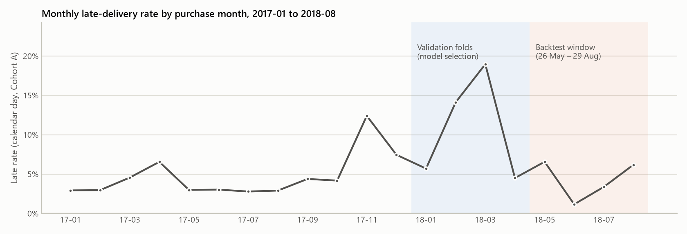

*图 2。Cohort A 中晚到订单的占比（按下单月份）。阴影分别是用于选模的验证月份和之后的回测窗口。*

延误率的变化：
- 2017 年平均 5.6%。
- 2017 年 11 月升到 12.4%。这是黑色星期五所在的月份，也是数据中订单最多的月份（7,288 个已签收订单）。
- 2018 年 2 月 14.1%，3 月 19.0%。
- 2018 年 6 月降到 1.2%，8 月又回升到 6.2%。

所以，在一个时期训练的模型总是在另一个"世界"里接受检验。这种漂移正是本项目的核心难点。

### 2.5 探索：选模时点的右删失

模型只能从结局已知的订单中学习。在选模截止时点（2018 年 5 月 26 日），有 104 个 4 月订单尚未送达，其中 89 单最终延误。于是 4 月的延误率在选模时看起来是 3.24%，实际是 4.50%。结局揭晓最慢的恰恰是延误单，所以最近的时期总是显得比实际好。我们坚持"不偷看当时未知的结局"，同时报告这种影响，而不是把它藏起来。

### 2.6 数据质量

- 166 个订单的交承运商时间早于下单时间，23 个订单的签收时间早于交承运商时间。
- 16 个已签收订单缺少重量和尺寸。
- 地理位置表有 261,831 行完全重复，另有 31 个坐标位于巴西境外，计算距离前都已剔除。

这些异常都不影响标签，模型也会对缺失输入做插补。

---

## 3. 方法

### 3.1 按时间顺序的评估设计

| 阶段 | 评估的下单期 | 训练数据 | 用途 |
| :--- | :--- | :--- | :--- |
| 验证折 1 | 2018 年 1 月 | 41,197 个此前已送达的订单 | 选方法 |
| 验证折 2 | 2018 年 2 月 | 47,794 | 选方法 |
| 验证折 3 | 2018 年 3 月 | 53,644 | 选方法 |
| 验证折 4 | 2018 年 4 月 | 60,468 | 选方法 |
| 回测 | 2018 年 5 月 26 日至 8 月 29 日（96 天） | 75,128，其中 7.11% 延误 | 对入选方法只测一次 |

每个截止时点的训练集只包含截止前已送达的订单，例如回测截止时仍在途的 2,048 单被排除在外。回测共为 19,661 单打分，其中 19,294 单属于 Cohort A，延误 674 单（3.49%）。窗口从 5 月 26 日开始，所以 5 月只贡献了 691 单。

### 3.2 下单时可用的信息

基础特征集有 74 个输入（68 个数值、6 个类别），包括：
- 购物篮大小、价格、运费、重量和体积
- 承诺时长
- 下单日历特征
- 买卖双方位置、距离、是否同州
- 历史特征

结果类历史特征（卖家、路线、州的延误率）只使用在当前订单下单时已经送达的更早订单；量类特征（卖家近期订单数）只统计更早下的订单。

扩展特征集另加 7 个支付特征。支付记录没有时间戳，下单时能否拿到只是假设，因此单独检验。

### 3.3 候选方法

| 类别 | 数量 | 设置 |
| :--- | ---: | :--- |
| 规则 | 5 | 随机顺序；常数先验；承诺越短越靠前；卖家历史延误率；路线历史 × 承诺紧迫度 |
| 逻辑回归 | 8 | C ∈ {0.1, 1.0} × 类别权重 {无, 平衡} × 特征集 {基础, 扩展} |
| 浅层决策树 | 16 | 深度 ∈ {3, 5} × 最小叶子 ∈ {150, 300} × 类别权重 × 特征集 |

模型概率在每个训练窗口最近的 20% 数据上校准（Platt 方法）。

**路线-承诺规则**（`rule_region_lead`，名称沿用历史标识）的打分方式是：

> 分数 = 路线延误率 × 承诺紧迫度。

- **路线延误率**：同一"卖家州 → 买家州"路线上更早已送达订单中的延误比例，以 5 单的权重向总体延误率收缩。
- **承诺紧迫度**：训练窗口中承诺时长的中位数（24 天）除以本单的承诺时长。本单承诺时长先限制在 3 到 90 天之间，比值限制在 0.5 到 2 之间。

历史差、承诺短的路线因此排在最前。这条规则只有两个输入、两个拟合数值：中位承诺时长和总体延误率（7.11%）。

### 3.4 选模规则（任何运行之前已固定）

选四个验证折上**每日前 10% 召回均值**最高的候选，即当天队列能装下的延误单占全部延误单的比例。模型只有在胜过最好的规则时才会被选中。候选网格和选模规则在第一次运行前就已写入配置。

### 3.5 评估

- **运营指标**：都在每日配额下计算，包括预警数、抓到的延误单（真阳性）、误报、精度（预警中延误的比例）、召回（延误单中被预警的比例）、提升度（精度 ÷ 基础延误率）。
- **排序指标**：平均精度（精度-召回曲线下的面积）和 ROC-AUC。
- **不确定性**：按周分块的 bootstrap，以整周为单位（回测共 15 周）重抽 2,000 次，保留延误在周与周之间的强相关性。
- **结局未知的订单**：精度给出一个区间，下限把这类预警全当误报，上限全当真实问题。
- **成本**：配置中固定的三种成本情景（4.7 节）。

有两项分析是在看过回测结果后才设计的：发货期限信号（4.6 节）和与"承诺越短越危险"规则的比较（4.4 节）。出现时都标为事后分析。

---

### 3.6 第二套预先登记的设计与检验期

2018 年的结果暴露了一些具体弱点，于是我们先把改进写下来、冻结在新的配置文件里，然后才运行：

- **考虑删失的标签。** 订单过了承诺日仍未送达，就已经可以确定延误，因此从第二天起就能进入训练和选模，不必等到签收。这样能找回原规则丢掉的延误样本：在 2018 年的设计下，4 月折训练集多了 652 单、最终训练集多了 107 单，选模时 4 月的延误单从 217 单增加到 278 单。
- **三条新规则。**
  - 路线历史只取最近 60 天的路线-承诺规则。
  - 同一规则改用考虑删失的 60 天路线延误率。
  - 承诺余量规则：承诺时长减去该路线最近的实际送达时间。
- **给模型的新特征版本**（`base_v3`），加入上述三项路线指标。
- **明确的选模门槛。** 模型必须比最好的规则高出至少 0.5 个百分点。

这套设计检验了两次：

- **2017 年末（真正的检验）。** 2017 年 6–9 月四个月度验证折，2017 年 10 月 26 日选模，回测 10 月 26 日至 12 月 31 日下的全部订单（67 天，包含黑色星期五）：14,023 单，其中 13,579 单已签收、1,358 单延误（10.0%）。配置在 2026 年 10 月 20 日 12:40 冻结，那时这段时期还没有任何模型打过分（附录 A）。
- **再跑一次 2018 窗口。** 这个窗口之前已经看过，所以这次运行属于事后分析。

修复后的流水线代码还把原来的 v2 设计重跑为 `experiment-v2-002`，按配置做 2,000 次 bootstrap（第一次只做了 400 次）。它的预测与原运行逐字节一致。

## 4. 结果

### 4.1 选模：规则胜过模型

| 候选 | 验证召回（4 折均值） | 最差一折 | 验证平均精度 | 回测召回 | 回测平均精度 | 回测 ROC-AUC |
| :--- | ---: | ---: | ---: | ---: | ---: | ---: |
| **路线-承诺规则（入选）** | **25.2%** | 23.2% | 0.206 | **17.4%** | 0.0604 | 0.6416 |
| 最佳逻辑回归（C = 0.1，扩展特征） | 21.0% | 2.9% | 0.168 | 15.1% | 0.0516 | 0.615 |
| 验证期最佳决策树（深度 5，叶子 300） | 15.6% | 12.6% | 0.135 | 12.3% | 0.0380 | 0.509 |
| 卖家历史规则 | 14.0% | 10.8% | 0.121 | 12.0% | 0.0349 | 0.491 |
| 常数先验 | 9.0% | 8.4% | 0.105 | 11.1% | 0.0349 | 0.500 |
| 随机顺序 | 8.9% | 7.2% | 0.103 | 10.4% | 0.0357 | 0.510 |
| 承诺越短越靠前 | 4.9% | 2.3% | 0.097 | **22.4%** | **0.1203** | **0.7503** |

*召回指每日前 10% 队列抓到的延误单占比。英文版附录 B 列出了全部 29 个候选。*

- **规则既领先又最稳定。** 路线-承诺规则在验证期领先 4.2 个百分点，最差的一折也抓到了 23.2% 的延误单。
- **逻辑回归很不稳定。** 最佳逻辑回归 4 月抓到 41.5%，2 月只有 2.9%。
- **其他模型更弱。** 支付特征几乎没有影响，浅层决策树更弱。
- **回测中没有模型超过规则。** 24 个模型抓到的延误单都不比规则多，最好的是 15.3%。

两个输入的规则为什么能赢 74 个特征的模型？
- 大部分预测信息集中在两件事上：订单发往哪里，以及承诺留了多少余量。
- 规则直接编码了这两点，并随着路线历史的更新自动调整。
- 模型则要从嘈杂且不断变化的数据里学出同样的结构。
- 随机排序按构造就能抓到约 10% 的延误单，各个模型都只是在此之上多了一点。

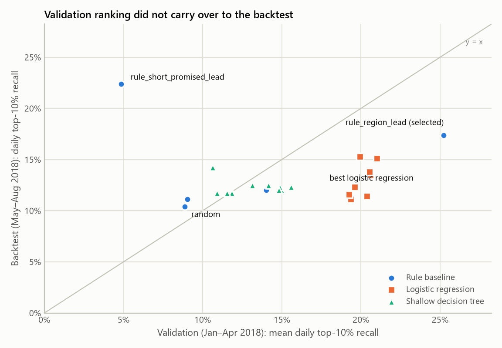

*图 3。每个点是一个候选。如果验证期能很好地预示回测期，点应落在对角线附近，事实并非如此。*

### 4.2 入选规则在回测中的表现

| 指标 | 数值 | 95% 区间（按周分块 bootstrap，2,000 次） |
| :--- | ---: | :--- |
| 预警数（每日配额，Cohort A） | 1,885 | — |
| 抓到的延误单 | 674 单中的 117 单 | — |
| 误报 | 1,768 | — |
| 召回 | 17.4% | 12.7% 至 27.0% |
| 精度 | 6.2% | 4.2% 至 8.4% |
| 相对 3.49% 基础率的提升度 | 1.78 | — |
| 平均精度 | 0.0604 | 0.0464 至 0.0805 |
| ROC-AUC | 0.6416 | 0.586 至 0.706（分析层） |

规则明显好于随机：整个精度区间都在基础率之上。但它很弱：团队每复核 16.1 单才找到 1 单延误，其中 15.1 单是误报。

- **严格时刻标签**：同一队列抓到 150 单延误，精度 8.0%、召回 14.7%。结论不依赖标签定义。
- **运营视角（Path B）**：对全部 19,661 单打分，共 1,922 个预警，每天约 20 单。其中 45 单（2.3%）结局未知：已发货未确认签收 35 单、取消 7 单、已开票 2 单、处理中 1 单。因此真实精度介于 6.0%（45 单全是误报）和 8.4%（45 单全是真实问题）之间。

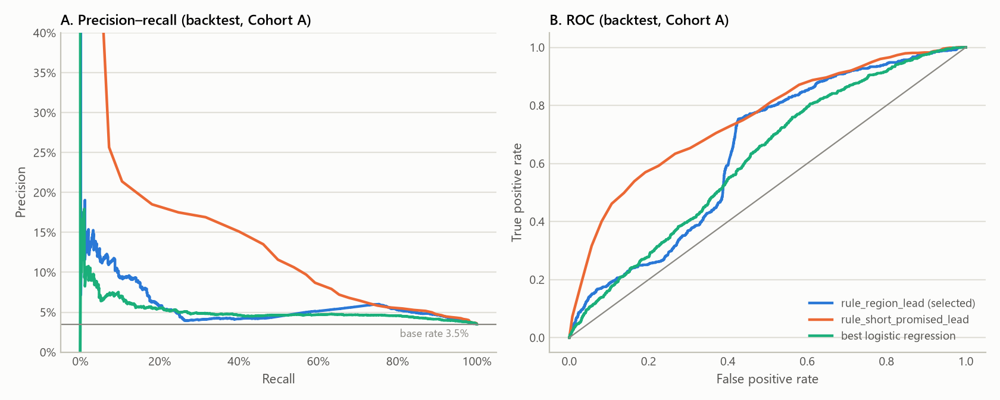

*图 4。入选规则、"承诺越短越靠前"规则与最佳逻辑回归在回测中的排序曲线。*

### 4.3 复核额度的取舍

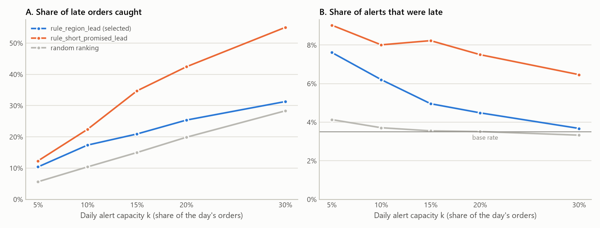

*图 5。在同样的每日配额规则下，召回和精度随每日复核额度的变化。*

| 每日额度 | 预警 | 抓到的延误单 | 精度 | 召回 | 提升度 |
| ---: | ---: | ---: | ---: | ---: | ---: |
| 5% | 919 | 70 | 7.6% | 10.4% | 2.18 |
| **10%** | **1,885** | **117** | **6.2%** | **17.4%** | **1.78** |
| 15% | 2,844 | 141 | 5.0% | 20.9% | 1.42 |
| 20% | 3,813 | 171 | 4.5% | 25.4% | 1.28 |
| 30% | 5,739 | 211 | 3.7% | 31.3% | 1.05 |

额度越大，精度越低；到 30% 时队列几乎和随机一样（提升度 1.05）。规则的价值集中在每天名单的最前面，团队扩大后多出来的人力主要会花在准时订单上。

### 4.4 两个时期之间发生了什么变化

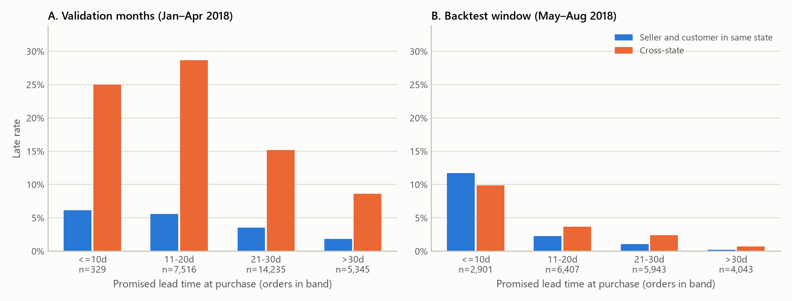

*图 6。验证月份（A）与回测窗口（B）中，按承诺时长和买卖双方是否同州划分的延误率。各档下方的 n 是该档订单数。*

**验证月份（2018 年 1 月至 4 月）：**
- 整体延误率 10.8%。
- 问题在跨州订单：跨州延误率 14.2%，州内 4.9%，全部延误单中 83.7% 是跨州的。
- 里约热内卢买家的订单有 22.0% 晚到。
- 10 天内的承诺很少见（329 单，占 1.2%）。

**回测窗口（2018 年 5 月 26 日至 8 月 29 日）：**
- 整体延误率只有 3.5%。
- 州内订单反而更危险：州内 5.1%，跨州 2.4%，59.3% 的延误单发生在同一州内。
- 10 天内的承诺变得常见：共 2,901 单，占 15.0%，其中 90.6% 是本地订单。这些订单延误率 11.6%，占全部延误的 49.9%。
- 圣保罗 → 圣保罗的短承诺订单（2,410 单）有 279 单延误，占该窗口全部延误的 41.4%。
- 承诺超过 30 天的订单几乎从不延误（0.7%）。

这种模式与"本地订单承诺日期的设定方式发生了变化"相吻合：短承诺大量出现，而且经常被错过。我们无法从数据中证实原因，但它解释了图 3 中的排名反转：
- 路线-承诺规则依赖路线历史，而这段历史主要建立在早期的跨州问题上，所以反应滞后。
- "承诺越短越靠前"规则在验证期毫无作用，因为那时短承诺既少又安全；到了回测期，它成了最好的候选（召回 22.4%）。

我们是否应该改选"承诺越短越靠前"规则？不应该，理由有两个：
1. **它的优势统计上不明确。** 召回差的配对按周分块 bootstrap 区间为 −13.4 pp 到 +13.9 pp，74.3% 的抽样对它有利（事后分析）。
2. **看过测试结果再换方法，会让回测变成训练集**，报告出来的表现就不再是诚实的估计。

真正的教训是：一个回测窗口只覆盖一种状态，必须持续监控，并在最新数据上重新选择方法。

### 4.5 分数只能用来排序，不是概率

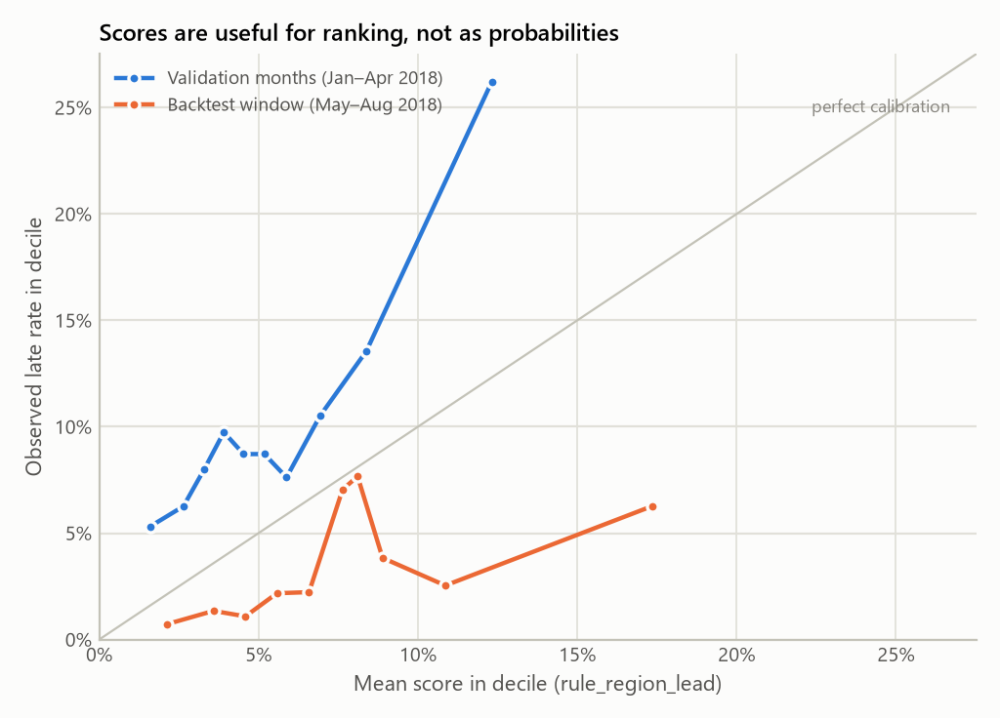

*图 7。两个时期中，按规则分数十分位划分的实际延误率与分数的对比。*

- **验证月份**：规则分数平均 5.5%，实际延误 10.5%，低估了约一半。
- **回测期**：分数平均 7.5%，实际 3.5%，高估到 2.16 倍；分数最高的十分位分数为 17.3%，实际只有 6.3% 延误。

所以这些分数可以用来给当天的订单排序，但绝不能当作概率解读，也不能与固定阈值比较。这正是每日配额的意义：它只用到分数的先后顺序。

### 4.6 一个更晚的信号：卖家错过发货期限（事后分析）

**多出来的时间花在哪里。** 图 8 回头看已完成的订单（这些信息从不用于预测）。晚到订单比准时订单多用了 22.9 天：
- 其中 19.9 天（87%）来自承运商运输：27.9 天对 8.0 天。
- 2.9 天（13%）来自卖家交接：5.5 天对 2.6 天。
- 27.8% 的晚到订单在卖家发货期限之后才交给承运商，准时订单只有 7.7%，相差 3.6 倍。

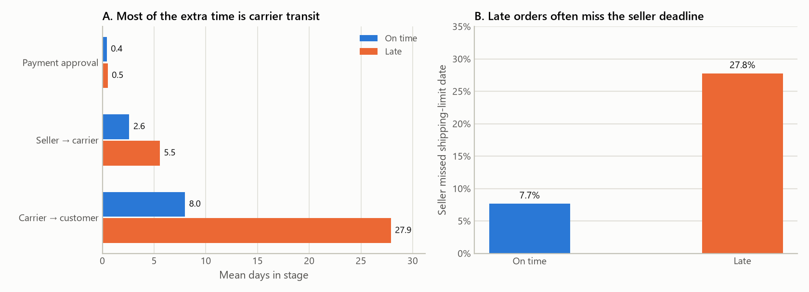

*图 8。A：各履约阶段的平均天数。B：卖家在发货期限之后才交给承运商的订单比例。基于全部已签收订单的事后数据。*

**把它变成预警规则。** 这提示了第二个检查点：在每个订单的发货期限时点，如果它仍未交给承运商，就预警。这在期限时点就能知道，不需要模型，也没有任何拟合参数。我们在同一批回测订单上评估了它：

| 预警方式 | 预警 | 抓到的延误单 | 精度 | 召回 | 提升度 |
| :--- | ---: | ---: | ---: | ---: | ---: |
| 下单时规则，每日前 10% | 1,885 | 117 | 6.2% | 17.4% | 1.78 |
| **卖家错过发货期限** | **1,575** | **306** | **19.4%** | **45.4%** | **5.6** |
| 任一信号 | 3,315 | 388 | 11.7% | 57.6% | — |

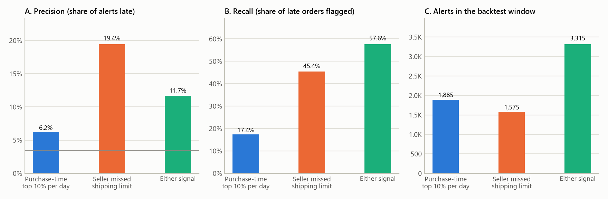

*图 9。两个信号及其并集在回测中的精度、召回和预警量（事后分析）。*

- **更准**：发货期限信号产生 1,575 个预警（占订单 8.2%，每天约 16 单），精度是下单时队列的 3.1 倍，召回是 2.6 倍。精度提高 13.2 个百分点，bootstrap 区间为 4.3 到 20.1 个百分点。
- **同量对比**：在相同预警量下，下单时排序只能达到 7.2% 的精度。
- **两个信号互补**：只有 35 单延误被两者同时标出。
- **仍有时间行动**：被预警时，订单距承诺日期的中位数还有 13.6 天；对最终延误的订单是 3.2 天，只有 2.2% 是在承诺日期已过之后才被标出。
- **效果取决于所处时期**：在验证月份，这个信号精度 22.8%，但召回只有 19.4%，因为 2018 年初的延误来自承运商运输，这个信号看不到。

### 4.7 是否值得行动：事先固定的成本情景

配置中定义了三种假设情景，金额单位任意（配置里标为美元）。对精度为 p 的一个预警，当 p × 收益大于联系成本加上 (1 − p) × 误报成本时，行动才划算。

| 情景 | 每抓到一单延误的收益 | 联系成本 | 误报成本 | 盈亏平衡精度 | 下单时队列（最优额度） | 卖家错过发货期限 |
| :--- | ---: | ---: | ---: | ---: | :--- | ---: |
| 保守 | 2.00 | 0.30 | 0.20 | 22.7% | 所有额度都亏损；10% 额度时每 1,000 单 −35.5 | −5.9 |
| 中等 | 5.00 | 0.25 | 0.15 | 7.8% | 亏损；5% 额度时每 1,000 单 −0.4，10% 时 −7.8 | **+49.0** |
| 高违约罚金 | 10.00 | 0.20 | 0.10 | 3.0% | 10% 额度时每 1,000 单 **+31.9**（最优） | **+135.7** |

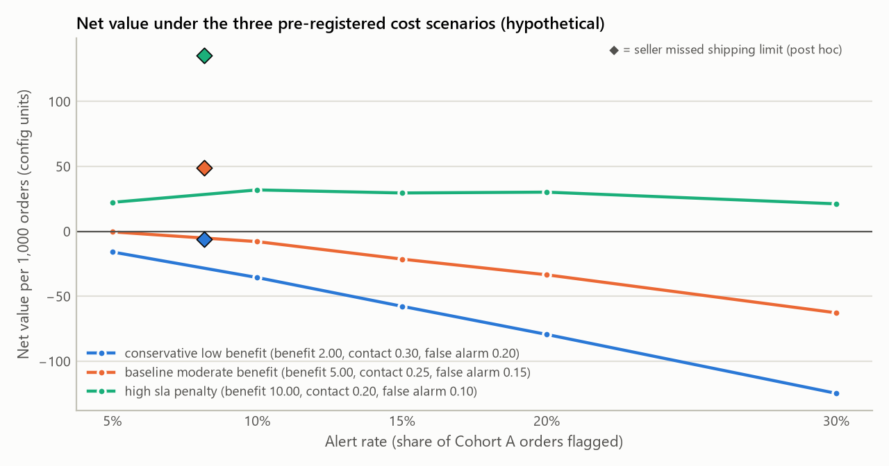

*图 10。每 1,000 个已签收订单的假设净值随预警比例的变化。折线：下单时队列；菱形：发货期限信号（事后分析）。*

精度 6.2% 的下单时队列，只有当抓到一单延误的价值至少约为一次联系成本的 16 倍时才值得运行，三种情景中只有最乐观的一种满足。发货期限信号则轻松越过中等情景。如果避免一次延误还能省下配置中单列的漏报成本，盈亏平衡精度会降到 15.6%、5.6% 和 2.0%，结论不变。这些情景只是示意：抓到延误到底值多少，完全取决于行动能否真正避免延误，而观测数据无法证明这一点。

### 4.8 第二次、预先登记的检验：2017 年末

| 候选（2017 年末检验） | 验证召回（2017 年 6–9 月） | 最差一折 | 回测召回 | 回测精度 | 回测平均精度 |
| :--- | ---: | ---: | ---: | ---: | ---: |
| **60 天路线 × 承诺（入选）** | **19.1%** | 16.4% | **21.1%** | **21.6%** | 0.151 |
| 考虑删失的 60 天路线 × 承诺 | 17.6% | 13.1% | 23.7% | 24.3% | 0.153 |
| 路线 × 承诺（v2 的入选规则） | 18.1% | 12.3% | 13.4% | 13.7% | 0.119 |
| 最佳模型（决策树，深度 5，叶子 300） | 18.7% | 6.3% | 17.3% | 17.7% | 0.122 |
| 承诺余量 | 16.0% | 12.3% | 8.3% | 8.5% | 0.123 |
| 承诺越短越靠前 | 12.7% | 9.7% | 4.2% | 4.3% | 0.092 |
| 随机顺序 | 10.3% | 9.7% | 10.2% | 10.5% | 0.102 |
| 卖家错过发货期限（不排序） | — | — | 34.0% | 28.9% | — |

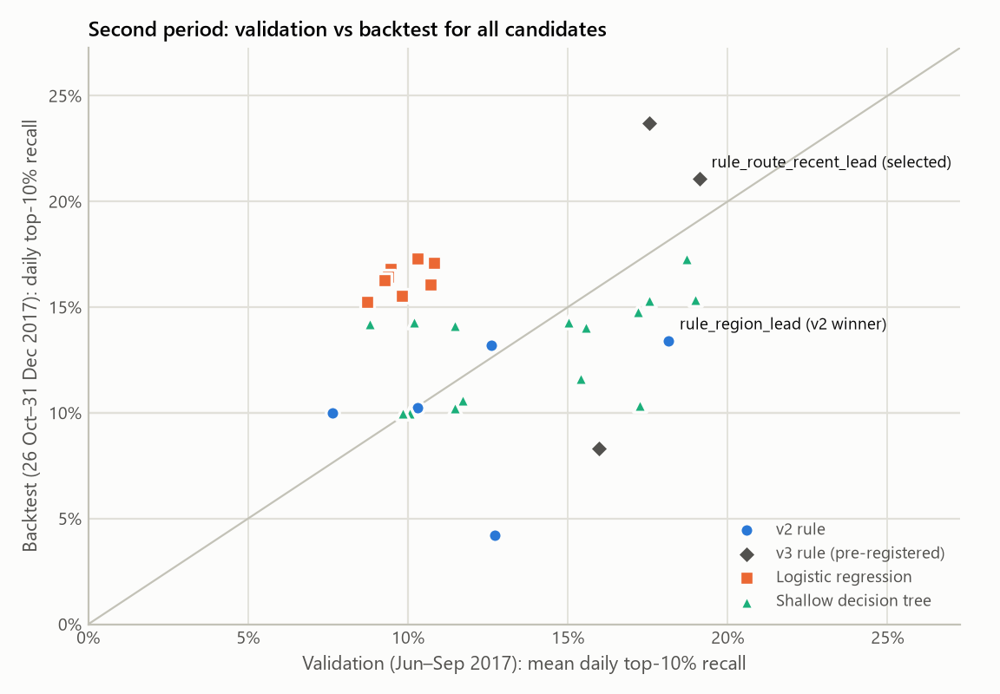

*图 11。每个点是预先登记设计中的一个候选：在 2017 年 6–9 月选模，在 2017 年 10 月 26 日至 12 月 31 日检验。*

**这段时期的特点。**
- 与 2018 年截然不同：验证月份的延误率很低（2.8% 到 4.4%），回测窗口则包含 2017 年 11 月的激增，已签收订单有 10.0% 延误。
- 选模再次选中了规则：最好的模型在验证期落后 0.4 个百分点，达不到 0.5 个百分点的门槛，而且它最差的一折只抓到 6.3% 的延误单。

**在没看过的窗口上的结果。**
- **近期历史有用。** 入选的 60 天路线规则抓到 21.1% 的延误单，精度 21.6%（提升 2.16 倍），原路线规则只有 13.4%。配对按周分块 bootstrap 给出的提升区间是 4.5 个百分点到 12.8 个百分点，2,000 次抽样全部有利于 60 天规则。入选规则自身的 95% 区间是 17.8% 至 25.9%。
- **考虑删失的历史还能再好一点。** 它的变体抓到 23.7%，是 32 个候选中最好的；但它在验证期只排第五，所以没有被选中。
- **2018 年事后看来的赢家无法推广。** 承诺余量（8.3%）和承诺越短规则（4.2%）都不如随机队列（10.2%）。如果当初看过 2018 年回测后改选其中任何一个，都会是错误的，这也说明在 2018 年坚持预先登记的选择是对的（4.4 节）。
- **发货期限信号在新数据上依然成立。** 它产生 1,599 个预警（占已签收订单 11.8%，每天约 24 单），精度 28.9%、召回 34.0%。精度比下单时队列高 7.3 个百分点（配对区间 1.4 到 13.6 个百分点，99% 的抽样为正）。最终延误的订单被标出时，距承诺日期的中位数还有 17.3 天。优势比 2018 年小，因为延误多时下单时排序也更容易。

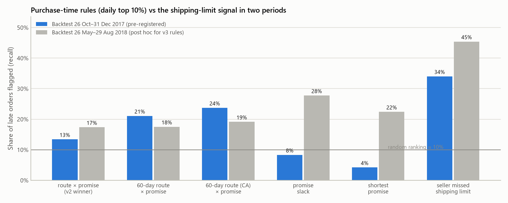

*图 12。每条规则的每日前 10% 队列召回，以及发货期限标记的召回：2017 年末回测（预先登记）与 2018 年回测（对 v3 规则属于事后分析）。发货期限标记不是排序队列，在 2017 年标出 11.8% 的订单，在 2018 年标出 8.2%。*

**高延误时期的成本。** 精度 21.6% 的下单时队列越过了中等情景 7.8% 的盈亏平衡线，每 1,000 个已签收订单 +69.4；在保守情景下大致持平（−2.5）。发货期限信号在中等情景下 +128.1，在保守情景下也有 +16.0。可见下单时行动的价值强烈依赖于当时的延误率。

### 4.9 新设计在 2018 窗口上的表现（事后分析）

在已经看过的 2018 年设计上，v3 再次选中原来的路线规则，考虑删失的标签没有改变选择。事后看：
- 60 天规则会抓到 17.5%（普通版）和 19.1%（考虑删失版），与入选规则的 17.4% 相差无几。
- 承诺余量会抓到 27.7%，但它在验证期只排第七，而且在 2017 年末失败了。

两个窗口共同的教训：基于近期的路线历史是稳健的改进；只在某一个回测中表现突出、却没有验证支持的规则不可信。

---

## 5. 建议

1. **不要组建大规模的下单时人工复核队列。** 在低延误的 2018 窗口，大约每复核 16 单才找到 1 单延误，只有在乐观的成本假设下才划算；在高延误的 2017 年末窗口，它在中等情景下就能盈利。所以下单时的投入应随当时的延误率调整。
2. **如果使用下单时排序，就以近期路线历史为基础。** 60 天路线规则赢得了预先登记的检验，召回比原规则高 7.7 个百分点。队列只取每天名单的最前面（那里精度最高），并优先采用低成本的自动化动作，例如预期管理消息或卖家提醒。
3. **把人工投入放在发货期限检查点。** 标出到期仍未交给承运商的订单。它在两个时期都比下单时队列更准：2018 年精度 19.4% 对 6.2%，从未看过的 2017 年末窗口 28.9% 对 21.6%。最终延误的订单被标出时，距承诺日期的中位数还有 3.2 到 17.3 天。应先做随机试点。
4. **复查本地短路线的承诺设定。** 承诺 10 天内的圣保罗 → 圣保罗订单产生了 2018 年回测期 41% 的延误。在这里加一点缓冲，可能比任何预警系统都更能减少延误。
5. **持续监控并重新选择方法。** 每月跟踪延误率、短承诺占比、分数与实际结果的比值，以及最近已结案订单上的召回。在最近的折上重新选模；如果考虑删失的 60 天规则持续领先，就改用它。
6. **度量干预的真实效果。** 早发现延误不等于能避免延误。随机对照试点（预警 vs 不预警）是估计成本情景所假设收益的唯一办法。

---

## 6. 批判性评估

### 6.1 数据的局限

- **只覆盖一个平台、一个时期。** 数据来自单一平台的 2016–2018 年，承运网络、承诺算法和卖家构成此后都可能已经改变。
- **承诺日期由 Olist 自己生成。** 标签衡量的是"Olist 自己的估计有没有兑现"，而不是送货速度。估计方法一变，标签就跟着变（4.4 节），而数据并不告诉我们它何时、为何改变。
- **时间戳质量。** 交接和送达时间可能记录得晚或不一致，166 个"交接早于下单"的订单就是例证。发货期限信号假设交接时间被及时记录。
- **结局未知的订单。** 有 2,971 单没有可观测的结局，我们只能给出它们对精度影响的上下界，无法消除这一影响。
- **信息是否可得。** 支付特征没有时间戳，下单时可得只是假设。好在它们本来就没起作用，影响有限。

### 6.2 方法的局限

- **验证折不具代表性。** 每套设计都是在与其检验窗口不同的四个月上选出的：2018 年的验证折包含数据中最剧烈的扰动，2017 年的验证折则是 11 月激增之前的平静期。
- **检验窗口都很短。** 2018 年 96 天（15 周）、2017 年末 67 天（10 周），区间都很宽。例如 2018 年的召回可能在 12.7% 到 27.0% 之间。
- **2018 年回测并非盲测。** 项目审计时计算过这个窗口的描述统计；第一次正式运行前不久，两次冒烟运行（候选网格缩小）也对它打过分，期间还修改过流水线代码。配置、候选网格和选模规则在此之前已经固定，之后没有改动；用最终代码重跑的冒烟运行也逐字节复现了之前的预测。尽管如此，它最好被描述为诊断性留出集。
- **第二次检验是新的，但在时间上更早。** v3 设计冻结时，2017 年末还没有任何模型打过分；但 v3 的想法来自对 2018 年的研究，而 2017 年末在 2018 年之前。它检验的是这些想法能否迁移到另一个时期，而不是能否预测未来。另外，2017 年的月度延误率事先画过图，分析者知道 11 月有一次激增。
- **bootstrap 次数。** 第一次正式运行（`experiment-v2-001`）因为代码写死，只做了 400 次 bootstrap，而不是配置的 2,000 次。修复后的代码以 2,000 次重跑为 `experiment-v2-002`，预测完全一致。
- **简化处理。** 多卖家订单只用主卖家的路线。模型概率是在比应用时期更早的时期上校准的，漂移使这种校准失效。
- **事后分析。** 发货期限信号和"承诺越短越靠前"规则的比较都是在看过 2018 年结果后设计的。发货期限信号后来在从未看过的 2017 年末窗口上也成立，但它仍然只是关联。

### 6.3 结论的局限

- 所有结果都是关联，没有任何证据表明联系卖家或买家能避免延误。
- 成本数值是假设的，只能说明盈亏平衡点在哪里，不能说明 Olist 实际能获得多少收益。
- "机器学习没有帮助"只对这些特征集、这些简单模型和这两个时期成立。更丰富的实时数据（例如承运商扫描事件）可能改变结论，这也和交接检查点上发现的更强信号一致。

---

## 7. 结论

在下单那一刻，Olist 的送达延误只是弱可预测的，而且能预测它的因素几个月就会变。在两个独立的检验期里，透明的路线-承诺规则都追平或胜过了 24 个机器学习模型。第二次、预先登记的检验表明：只用近期的路线历史能让规则明显更好（召回 21.1% 对 13.4%），而事后看来最好的规则无法迁移。下单时队列值不值得运行，取决于当时延误多不多。

错过发货期限在两个时期都是更准的预警，而 2018 年延误集中在本地短承诺上，说明该修正的是承诺的设定方式。对运营团队来说，决策是：
- 把人工注意力移到交接检查点；
- 下单时的投入保持小规模，并基于近期历史；
- 推广任何干预之前先做试点。

---

## 附录 A：可复现性与证据

- **正式运行**：`artifacts/runs/experiment-v2-002`（VERIFIED；配置为 `configs/experiment-v2.json`；原始数据按 SHA-256 校验）。它是 `experiment-v2-001` 的修复代码重跑版，预测完全一致，bootstrap 2,000 次。
- **第二套设计**：`experiment-v3-late2017-001`（预先登记的检验期）和 `experiment-v3-2018-001`（事后分析），均为 VERIFIED。配置为 `configs/research-v3.json`、`configs/experiment-v3-late2017.json`、`configs/experiment-v3.json`。
- **分析层**：
  - `scripts/report_analysis.py` 输出到 `artifacts/analysis/experiment-v2-002-report/`；如果不能完全复现正式运行的核心计数，它会拒绝运行。
  - `scripts/robustness_analysis.py` 为第二套设计输出 `artifacts/analysis/robustness-report/`。
- **文档检查**：`scripts/check_docs_consistency.py` 确认本报告、幻灯片和简报中的每个数字都与两个 `report_facts.json` 或配置中的某个值一致，且所有图片链接有效。
- **暴露时间线**（见 `docs/test-exposure-log.md`）：
  1. 2026-10-19，一次旧版诊断运行中途中断，从未对 2018 窗口打分。
  2. 10 月 20 日 00:37，v2 配置冻结。
  3. 02:30 和 02:37，冒烟运行对 2018 窗口打分。
  4. 02:47，第一次正式运行开始。
  5. 12:40，v3 配置冻结。
  6. 12:46，2017 年末运行开始，这是第一次对该时期打分。

